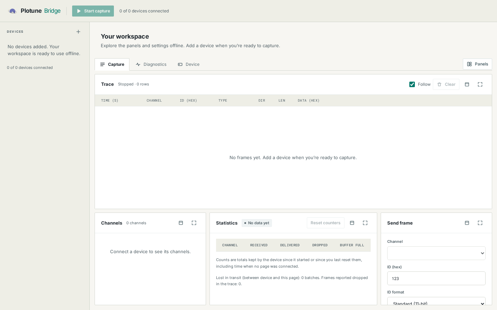
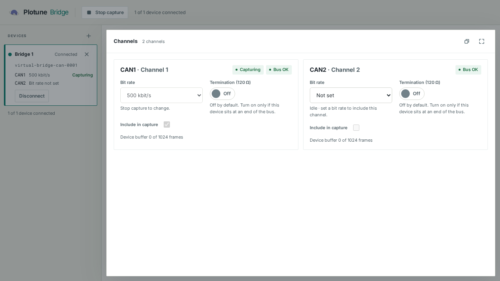

# Plotune Bridge Web

The static Plotune Bridge workspace, served from GitHub Pages at **https://bridge.plotune.net**. It connects straight from the browser to a Bridge CAN device (or the reference virtual device) and gives you a two-channel trace, send, status and drop reporting, plus client-side ISO-TP, generic UDS and XCP-on-CAN tools.

This repository is public. It is a static build: **no server-side code, no secrets, nothing private**.

| Workspace with no devices | One configured channel |
|---|---|
|  |  |

The channel screenshot uses the reference virtual device, not physical hardware.

## Browsers

| Browser | Direct connection | Notes |
|---|---|---|
| Chrome, Edge, Brave (Chromium) | **Supported target** | On a public HTTPS page the browser first asks "access devices on your local network". The page explains the prompt before connecting, and a Block answer produces a message and a retry. |
| Firefox, Safari, any browser on iOS | **Not supported yet** | In the reachability tests, Firefox and WebKit (the engine Safari and every iOS browser use) blocked plain `ws://` from an HTTPS page; Safari itself was not tested. The page says so up front and does not try the blocked connection. `wss://` is not pre-judged and is attempted; `ws://localhost` is allowed in Firefox, where it worked. |

The connection layer sits behind an adapter interface so a WebRTC or helper transport can replace the WebSocket one later.

## Use it

1. Open the workspace. Capture, Diagnostics settings and Device views work with no devices added. When ready, choose **Add a device** and read the permission explanation.
2. Enter the device address (`192.168.1.50:9101`, or a `wss://` address). **The device must list this page's origin as allowed**; see [docs/device-requirements.md](docs/device-requirements.md). The page shows the origin to add, with a copy button.
3. Choose **Allow** when the browser asks about local network access.
4. Set a bit rate on the channel(s) you want to use, then **Start capture**. Unconfigured channels stay idle and are excluded. Sending requires a bit rate only on the selected channel.

The workspace works like a measurement window: a device list on the left, the trace filling the top of the screen, and Channels, Statistics and Send frame tiled underneath. **Several devices** (up to eight) can be connected at once; Start capture / Stop capture in the top bar acts on all of them, the selected device is the one the panels act on, and the Trace shows all devices merged in arrival order (each row names its device) or one device at a time. Capture shows each device's channels in one trace with the device's timestamps. Nothing is relabelled or discarded silently: every row keeps the channel, the 64-bit device timestamp and the direction; frames the device could not deliver are counted per channel and marked in the trace; frames lost in transit are counted separately; rows that scroll out of the bounded view are counted too.

## Develop

Requires Node 22 or newer.

```bash
npm install
npm run dev            # http://localhost:5173 (allow this origin on the device)
npm run lint
npm run typecheck
npm test               # unit and component-level tests (Vitest)
npm run build          # static site in dist/
npm run preview        # serves dist/ at http://127.0.0.1:4173
npm run test:e2e       # browser tests against the production build (needs Chromium: npx playwright install chromium)
npm run contract:verify
```

### Tests

| Command | What it covers | Needs |
|---|---|---|
| `npm test` | 64-bit timestamp codec, strict decoders, the vendored conformance fixture validated against the JSON Schema, transport and notices, session, store (success, permission denied, transport failure, replaced session, overflow, device switching), ISO-TP, UDS, XCP, brand colour contrast | Node |
| `npm run test:e2e` | The same scenarios in real Chromium against a contract-faithful mock device over a real WebSocket, including `wss://`, panels, diagnostics, axe accessibility scans and a no-console-errors / no-CSP-violations session | Chromium |
| `npm run test:virtual` | The workspace against the **real** Plotune virtual device and the generator/bench ECU over WebSocket | those servers (below) |
| `npm run screenshots` | Regenerates `docs/screenshots` | Chromium, and the servers for two of the shots |

The browser's local-network permission prompt cannot be shown or answered by automation. The permission-denied tests **simulate** it (a blocked connection and a `denied` answer from the Permissions API), and they are named and commented as simulations.

`npm run test:virtual` skips itself unless these are set (they run privately because the device simulators live in a private repository):

```bash
BRIDGE_VIRTUAL_URL=ws://127.0.0.1:9101        # virtual device: 2 channels, seeded generator, loopback
BRIDGE_SINGLE_CHANNEL_URL=ws://127.0.0.1:9141 # fresh 2-channel virtual device (CAN2 must remain unconfigured)
BRIDGE_VIRTUAL2_URL=ws://127.0.0.1:9121       # a second virtual device (two real devices in one workspace)
BRIDGE_OVERFLOW_URL=ws://127.0.0.1:9111       # virtual device: tiny buffer, fast generator
BRIDGE_BENCH_URL=ws://127.0.0.1:9202          # generator's paired Bridge endpoint (synthetic ECU behind it)
BRIDGE_BENCH_CONTROL_URL=ws://127.0.0.1:9201  # generator control endpoint
BRIDGE_BENCH_ORIGIN_URL=ws://127.0.0.1:9302   # a second bench started with --ws-origin https://bridge.plotune.net
```

### Remembered workspace and offline use

[Persistence details](docs/persistence.md) describe the versioned localStorage schema,
legacy preference migration, validation and storage-failure fallback. After a reload,
the last view and remembered device list return **disconnected**. Choose Reconnect (a remembered remote device reconnects by itself once you have signed in);
hello/status reads the device's current bit rate, termination and armed state. The
browser never reapplies a saved hardware configuration or automatically takes over
a device. Capture inclusion and send-channel choices are browser preferences only.

“Offline” here means a loaded workspace without a device or Cloud connection; no
service worker/offline installation is added. The shell leaves panels available for
future standalone tools; DBC/A2L viewers and an offline calibration setter are not
implemented. Native browser local-network prompts and hardware remain unverified.

### Sign-in

Bridge has no password form. plotune.net is the only login page: **Sign in with Plotune** (or **Sign in** in the top bar) sends the browser to `https://www.plotune.net/bridge/authorize` with a random PKCE (S256) challenge and state. After signing in there, plotune.net returns the browser to this page with a one-time code in the URL fragment. The page clears the fragment at once, checks the state, and exchanges the code and its verifier for an account token.

- The PKCE verifier and the state are kept in `sessionStorage` only until the return trip uses them. The code, the token and the verifier are never written to `localStorage`.
- The token is never stored. A page load signs in again through plotune.net (`prompt=none`), a quick bounce while the page shows **Signing you in with your Plotune account…**. A signed-in browser comes straight back with a new code, and the remembered remote devices then reconnect once.
- The automatic attempt runs on a page load when there is no token in memory, the browser keeps session storage, you have not signed out in this tab, and no earlier attempt failed.
- The automatic attempt stops for the tab after a failure: a `login_required`, `access_denied` or other error return, a state mismatch, a failed exchange, or an earlier attempt that never came back (for example after the back button). The page then shows **Sign in** and does not retry on its own. A successful sign-in clears the failure, and so does **Sign in** or **Switch account**.
- **Sign out** in the account menu forgets the account in this page and stops automatic sign-in for this tab until you choose **Sign in**. It does not touch plotune.net. **Switch account** asks plotune.net for its login form.
- Sign-in is only active on `https://bridge.plotune.net`, the one address plotune.net returns to. On any other origin (a local build such as `http://localhost:4173` or `http://127.0.0.1:4173`, or a preview) the page makes no automatic attempt and does not redirect. **Sign in** and **Sign in with Plotune** show a notice that sign-in works on bridge.plotune.net, and the local-network workspace (**Advanced: connect on the local network instead**) keeps working as before.

### Remote mode

Remote mode needs a signed-in account (see **Sign-in** above).

1. Choose the project. Its devices are listed. The page remembers the chosen project and the remote devices you connected to, as IDs only. A remembered remote device is reconnected automatically after each sign-in; until then it shows an informational **Sign in to connect to your device** card with **Sign in with Plotune** and **Use the local network instead**.
2. To add a device, choose **Add a device** and enter the one-time `plt_pair_…` code on the Bridge device within 2 minutes.
3. Choose **Connect** next to a device. The connection goes through the Plotune cloud relay (WebRTC).

The local-network address form is still available behind **Advanced: connect on the local network instead**, and it works as before.

### Looking at the interface while developing

`node scripts/dev-shots.mjs <label> [baseUrl] [addr1,addr2,...]` drives a running preview or dev server (default `http://127.0.0.1:4173`) with two devices and saves screenshots of the Capture, Diagnostics and Device windows, and a phone-width Capture view, into `.dev-shots/<label>/` (ignored by git). Take one before and one after a change to compare them.

## The device contract copy

[`contract/`](contract) holds a copy of the Bridge CAN device contract's JSON Schema and conformance fixture, taken from `plotune-nexus`. The **drift check runs in the `plotune-nexus` CI, not here**.

To update the copy from a `plotune-nexus` checkout:

```bash
node scripts/sync-contract.mjs --from ../plotune-nexus   # copies the files, records the source commit and SHA-256 of each
npm run contract:verify                                  # offline: the local files still match contract/SOURCE.json
```

`contract/SOURCE.json` records the source commit and checksums. The sync refuses to run if the source folder has uncommitted changes. The tests validate the fixture against the schema, so a bad sync fails loudly.

## Structure

```
src/protocol/     64-bit-safe JSON codec, strict decoders, contract types and errors
src/transport/    DeviceTransport interface, WebSocket adapter, plain-language close/failure notices
src/device/       one protocol session over a transport (hello, requests, events, sequence gaps)
src/state/        device stores, multi-device hub, versioned browser preferences, bounded trace buffer
src/diagnostics/  client-side ISO-TP, generic UDS, XCP on CAN, shared settings
src/components/   panels, pages, connection screens, original icons
src/lib/          browser detection and connect policy, address parsing, permission query, helpers
src/styles/       tokens.css (brand tokens with sources) and app.css
```

To add a transport, implement `DeviceTransport` (`src/transport/types.ts`): open a link, send and receive whole contract messages, report closes with a `CloseInfo`. Nothing above the interface changes.

## Deploy

`.github/workflows/deploy.yml` builds the static site and publishes `dist/` with GitHub Pages on every push to `main`. Set **Settings → Pages → Source: GitHub Actions** and the custom domain `bridge.plotune.net` in the repository settings; DNS is configured outside this repository. The build uses relative asset paths, so it also works from a sub-path.

The page sets its own Content-Security-Policy through a `<meta>` tag because GitHub Pages cannot set headers. `connect-src` has to allow `ws:` and `wss:` to any host because a device's address is not known in advance. It also allows `https://api.plotune.net` (account sign-in) and `https://stream.plotune.net` (projects, devices, pairing codes and the remote relay). Nothing is loaded from third parties; fonts are bundled.

## Scope

**Built:** device connection over WebSocket; permission explanation, denial handling and retry; unsupported-browser notice; replace-on-connect and close-code handling; two-channel capture with a basic live trace; channel and device status; drop, overflow and transit-loss display; send frame; client-side ISO-TP, generic UDS and XCP-on-CAN; maximizable and full-screen panels with a show/hide menu; light Plotune theme; Plotune account sign-in through plotune.net; remote access through the Plotune cloud relay (WebRTC).

**Not built (candidates, not commitments):** trace filtering and search, plots and numeric panels, ASC recording/export, DBC import and signal decoding. The trace is deliberately a plain live table. Also not built: any CAN FD view (Classic CAN only).

## Assumptions

- The Chromium prompt and its wording, and the permission names the page queries (`local-network`, `local-network-access`, `loopback-network`), are taken from reachability tests and may differ by release. A failure to read the permission is treated as "unknown", never as "denied".
- A failed connection gives the page almost no detail (always close code 1006), so the notice lists the usual causes instead of asserting one. If the Permissions API reports `denied`, that is named as the cause.
- The diagnostic IDs on the Diagnostics page (UDS `7E0`/`7E8`, XCP `600`/`601`) are examples; users enter the ones their target uses.
- The page does not reconnect automatically.
- "Delivered" in the statistics means the device handed the frame to the connection. A transport that loses data afterwards shows up as a stream-sequence gap, shown separately as "lost in transit".

## Not tested

- **Real Chrome and Edge** local-network permission behaviour, including how long a decision is remembered and what a hard block of `ws://` in a future release would look like. Only the simulated prompt is automated; the prompt was observed manually once in Brave on Linux during the reachability work.
- **Firefox and Safari** as real browsers. The unsupported-browser tests drive Chromium with a Firefox user-agent string, so they test the page's decision, not those browsers.
- **A physical Bridge**, USB networking, and a separate LAN host. Everything ran against software simulators on one machine.
- **A trusted `wss://` certificate on a device.** The `wss://` test uses a throwaway self-signed certificate that only the test browser accepts.
- **GitHub Pages hosting** itself (the deploy workflow has not published anything yet) and the real response headers of the hosted site.
- Mobile browsers and screen readers (automated axe checks only).
